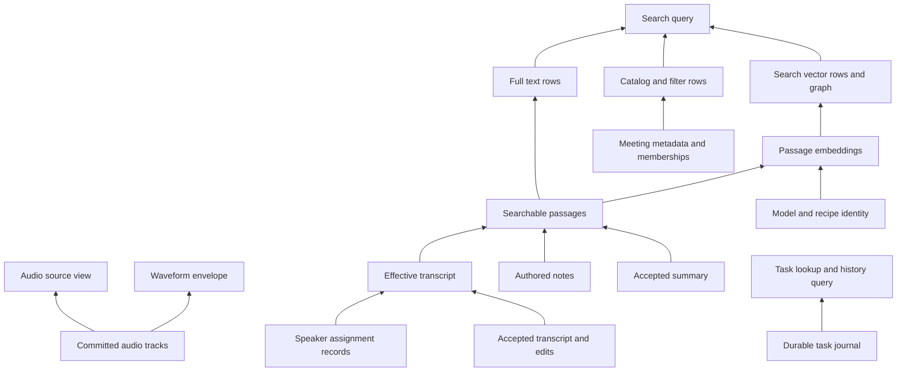

# Purpose and proposed direction

Organize the Swift macOS app's data as a directed acyclic data graph. Each feature registers nodes for the data it owns, with explicit dependencies, storage formats, read and write operations, cache policies, and recovery behavior. A request uses the nearest valid cached result. When that result is missing or stale, the graph resolves its dependencies, each through the same cache-first process, and rebuilds only the requested result and its required inputs. Files remain authoritative for library content; the shared SQLite database remains a disposable projection.

The goals are clear ownership, predictable data flow, less duplicated state, efficient updates, and a stable library file specification for app version 1.0.0. This proposal is pending. It does not authorize a format migration or change current storage behavior.

This is the v2 evolution of [File-authoritative meeting library and disposable index](2026-09-27-large-library-storage.md) and [Shared disposable library database](2026-10-05-shared-library-database.md). Those documents describe the existing foundation. The [search task proposal](2026-10-06-search-index-tasks.md) remains the reference for durable processing controls. This design extends ownership beyond indexes to source documents, accepted processing results, assets, journals, preferences, and caches.

## Scope

Cover the Swift app's local files, persisted preferences, and adapters for secure credentials. Include files outside the chosen library, such as local indexes, waveform caches, and model installations. Exported files become independent artifacts after export; the app does not maintain a live dependency graph for another application's copy.

Keep provider protocols, recording codecs, model implementations, and the visual design of Tasks outside this proposal. Integrate their existing operations through contracts rather than replacing them. A graph inspector can be designed separately after the query contract works.

# Authority before derivation

Audio and meeting metadata are foundational sources, but they are not the only sources of truth. Notes, edited transcripts, people, tags, speaker assignments, and user decisions cannot be reconstructed from audio. A saved generated result can also be authoritative: rerunning a model may produce a different result or require a provider that is no longer available.

Separate authority, provenance, and storage lifetime. Persisted does not mean authoritative; derived does not mean disposable.

| Data class | Meaning | Allowed recovery |
| --- | --- | --- |
| Authored or captured source | Audio, imported attachments, notes, metadata, edits, people, tags, assignments | Restore from backup or explicit import; never invent missing content |
| Accepted result | A saved transcript, summary, labeling result, or voice decision with its origin recorded | Preserve the exact saved result; a new inference creates a new result |
| Durable operation or history | Task intent, provider request binding, recovery checkpoint, audit/search events, archive receipt | Replay or resume according to its owner; do not discard as cache |
| Reusable computation artifact | Embeddings or prepared model data with a defined recipe and inputs | Recompute only under its declared cost and execution policy |
| Disposable projection | Catalog, full-text rows, task offsets, search graph, waveform envelope | Rebuild from declared dependencies |
| Temporary work | Unpublished staging files and conversions owned by a live operation | Clean up only after proving no operation or recovery procedure still owns them |

Live recording checkpoints remain durable recovery state until finalization has committed and recovery no longer needs them. An image preview referenced by Markdown remains a referenced asset even when its pixels can be regenerated. Voice-library decisions and enrollment provenance remain durable; only separately identified representations may qualify for recomputation.

# Data ownership and contracts

Every persistent path pattern and preference namespace has exactly one writer. Features receive storage capabilities for their declared namespace; UI code sends commands rather than choosing paths. The graph runtime coordinates reads, cache resolution, and commits, while feature adapters own parsing, validation, and domain rules. Long-running execution belongs to the existing task scheduler.

Registration fails for overlapping ownership, duplicate node kinds, unknown dependencies, or dependency cycles. Shared files require one owning adapter that composes validated feature updates; multiple features must not independently rewrite the same JSON document. A new feature cannot persist data until its contract and recovery tests are registered.

## Required contract fields

| Contract field | Required definition |
| --- | --- |
| Identity and owner | Stable node kind, entity key, responsible module, and storage namespace |
| Authority and lifetime | Data class, retention policy, backup inclusion, and whether deletion loses information |
| Format | Encoding, schema version, validation, limits, and unknown-field behavior |
| Dependencies | Allowed input node kinds, concrete keys, field projections, and configuration/model inputs |
| Revision | Canonical digest or committed append boundary, including the normalization version |
| Reader | Typed output, paging/streaming behavior, consistency requirements, and missing-data semantics |
| Writer | Permitted commands, expected input revisions, atomic publication, and conflict handling |
| Derivation | Recipe version, reproducibility limits, resource requirements, and execution policy |
| Cache | Memory/disk placement, validity proof, eviction limits, shared result identity, and miss behavior |
| Invalidation | Which changes make the result stale; whether stale reads are permitted |
| Recovery | Rebuild, resume, redownload, restore, or explicit non-recoverability |
| Deletion | Referential checks, cancellation, removal from projections, and retained history |
| Observability | Work counts, bytes read/written, cache reuse, reasons for invalidation, and failure reporting |

Contracts are compiled into the app. Files contain data and version identifiers, never executable resolver code or arbitrary queries. Registry metadata can generate a storage inventory, format reference, and dependency diagram so documentation and implementations share the same declarations.

## Initial ownership map

These are proposed contract boundaries around existing stores, not new filenames. The implementation audit must include transitive writes made by framework and provider adapters.

| Owner | Files or data | Primary responsibilities |
| --- | --- | --- |
| Meeting documents | Metadata, content, notes, current transcript, summary, transcript revisions | Field authority, editing, accepted results, and revision checks |
| Capture | Audio tracks and unfinished recording checkpoints | Append boundaries, finalization, and crash recovery |
| Attachments | Original assets, preview assets, and preview mapping | Content identity, reference validation, regeneration, and safe cleanup |
| People and tags | Entity documents and membership decisions | Stable identities and relationship commands |
| Speaker results and voice library | Analysis evidence, accepted assignments, examples, representations, jobs, decisions, undo | Separate durable decisions from reusable computation |
| Task journal | Task intent, attempts, request bindings, and terminal results | Durable execution state and recovery |
| Search | Passage projections, saved embeddings, search rows, and graph snapshots | Recipe identity, vector reuse, ranking inputs, and rebuild |
| History and archive | Data-event journal, provider search logs, archive receipts | Append semantics, retention, and provenance |
| Settings and credentials | Settings file, preferences, Keychain references | Configuration authority and destination-bound credentials |
| Models and provider metadata | Model assets, validation receipts, model/language lists | Download identity, validation, freshness, and availability |
| Storage infrastructure | Shared database container, event cursors, generated guides | Transactions and lifecycle; feature owners retain ownership of their tables |
| Waveforms | Waveform envelopes in the local cache | Audio identity, regeneration, and bounded retention |

# Dependency graph

## Separate dependency edges from references

A derivation edge records that a consumer's value depends on an input node and its revision. These edges must be acyclic. Entity references, historical provenance, and task relationships are different edge types; they do not automatically schedule work. A person can reference a meeting and a meeting can reference a person without creating a derivation cycle.

Declare dependencies directly between nodes. The runtime derives execution order from those edges and can resolve independent inputs concurrently. Node identity, ownership, authority, and cache location do not depend on position in the graph.

Validate declared node-kind dependencies at registration and concrete edges when a plan expands. Dynamic inputs must use declared dependency kinds. Check for cycles before joining in-flight work, including cycles across concurrent requests, so shared requests cannot wait on one another indefinitely. A rejected plan identifies the cycle and its owners.

A node may represent a document, a field projection, a reusable artifact, a collection, or a query. Choose granularity around independent ownership, revision, and reuse; do not create one node for every scalar field automatically. A cross-meeting aggregate depends on a versioned collection membership node as well as its selected members, so additions and deletions invalidate it correctly.

In the diagram, arrows point from an input to its consumer. Requests travel toward dependencies; resolved values return toward the requester. Invalidation follows the arrows toward affected consumers.



## Generated results do not create hidden feedback loops

Transcription, summarization, Speaker Diarization, and Speaker Association are commands that consume pinned source revisions and produce candidate result records. Speaker Diarization distinguishes voices; Speaker Association matches those voices to the People Library. Saving or accepting a result is a source mutation with provenance, not a query resolver writing back into one of its inputs.

For example, summarization can consume transcript revision A and create summary result B. Accepting B updates the current summary reference. It does not change A or rerun summarization automatically. A subsequent transcript edit marks B as based on an older input without deleting it or starting a paid request. Explicit automation may enqueue another command under its existing policy.

Imported transcripts without audio remain valid sources. Meetings may contain zero, one, two, or more audio assets; the format must not assume exactly two tracks. Track role and alignment are metadata, independent of filenames.

# Typed queries and commands

Use a local Swift API with the useful properties of a graph query system: typed outputs, declarative dependencies, resolver reuse, batching, cache policy, and inspection. A GraphQL schema, parser, network endpoint, and arbitrary client query language are unnecessary for the first implementation. A future external API can adapt the same contracts without defining storage ownership again.

The following is an interface sketch, not a compiling API commitment:

```swift
protocol DataNode: Sendable {
    associatedtype Key: Hashable & Sendable
    associatedtype Value: Sendable

    static var contract: NodeContract { get }
}

protocol DerivedDataNode: DataNode {
    func dependencies(for key: Key, in context: PlanningContext) async throws -> DependencyPlan
    func resolve(_ key: Key, from inputs: InputSnapshots) async throws -> ProposedArtifact<Value>
}

protocol SourceDataOwner: DataNode {
    associatedtype Command: Sendable
    func readSource(_ key: Key, in context: ReadContext) async throws -> NodeSnapshot<Value>
    func prepare(_ command: Command, expecting revisions: RevisionSet) async throws -> ProposedCommit
}

// Intent examples; requests carry policy and library identity.
let page = try await data.query(MeetingPage.after(cursor), policy: .localSnapshot)
let impact = try await data.inspect(.dependents(of: sourceKey))
let plan = try await data.planRebuild(.search, policy: .reuseValidatedArtifacts)
```

`NodeSnapshot` includes the value, revision, consistency token, freshness, and diagnostics. Missing, unavailable, malformed, stale, and unsupported-version states remain distinct. A query cannot silently turn unreadable content into an empty successful result.

All consumers, including other nodes, request data through the graph runtime. The runtime owns cache lookup, dependency traversal, shared work, and publication; adapters provide codecs, source reads, dependency declarations, and computations. A derived resolver receives resolved snapshots and cannot bypass the graph to read undeclared files. Planning may request declared discovery nodes when concrete dependency keys are not yet known; those requests follow the same validity and cycle checks.

Consistency tokens pin the relevant dependency revisions, not every file in the library. Unrelated commits must not invalidate a read. A query joining several projections either returns a compatible generation set or explicitly reports an allowed stale result; it must not silently combine incompatible transcript and speaker revisions.

Inspection queries expose owners, dependencies, dependents, source locations, freshness, invalidation reasons, retained references, and available recovery actions. They can answer “Why was this recomputed?”, “What changes if these notes are edited?”, and “Which files are safe to rebuild?” without loading all meeting content or running resolvers. Page large dependency expansions and redact credentials and private content from routine diagnostics.

Read policies distinguish a committed local snapshot, an explicitly permitted stale projection, and a request for current derived data. Ordinary local cache repair can happen automatically on demand. If repair needs inference, downloads, credentials, or other policy-controlled work, execute only under an existing applicable authorization; otherwise return a work requirement or existing task reference. A cache miss does not grant permission to upload content or download models. Submitting an explicit rebuild plan uses the same resolution machinery under its declared policy.

# Demand driven resolution and caching

## Request algorithm

For each requested node key:

1. Check the node's memory cache, then its persisted artifact if the contract allows one. Validate the receipt, recipe, storage availability, and freshness against the request's consistency requirements.
2. Return a valid hit immediately. Do not invoke its resolver or load dependency payloads merely to produce an already valid result.
3. On a miss, join compatible in-flight work or create one bounded resolution request. Expand the declared dependency plan and request each input through the graph. Every input follows this same algorithm, stopping independently at its nearest valid cache or authoritative source.
4. If an authoritative source is missing, unavailable, or malformed, return that state. Recursive cache repair cannot recreate lost source data or silently replace an accepted result with new inference.
5. Once required inputs are available, run the resolver with pinned input revisions and the permitted execution policy. Propagate blocked inputs without publishing a partial result as complete; partial output requires an explicit node contract.
6. Recheck the relevant revisions, atomically publish the result and receipt, and return one shared immutable snapshot to waiting consumers. Cache according to the node's policy, including the option to retain nothing after consumers release it.

The graph expands only as far as needed for the request. A cache miss in a catalog query must not rebuild unrelated waveforms or run transcription. Independent dependency branches can resolve in parallel within resource limits; shared dependencies resolve once for the same compatible request identity.

## Nearest valid cache

“Nearest” means the first valid result encountered while resolving from the requested node toward its inputs. If a query result is cached and current, use it. If it is missing but the index is valid, answer from the index. If the index is missing but saved embeddings are valid, rebuild the index from those embeddings. Recompute embeddings only when needed and permitted. Each branch can stop at a different node.

Validity must be cheap to establish without assuming that an existing file is current. Use dependency revision receipts and reconciled invalidation state to avoid rereading all inputs on every hit. A cold start or gap in event history makes affected receipts unverified until revision reconciliation catches up. A request requiring current data waits for the necessary verification; a request allowing older data receives an explicitly stale snapshot. A missing or corrupt payload is a miss even when its receipt claims to be current.

Cache eviction and source invalidation are different. Evicting a dependency's cached bytes does not make a downstream result stale when its input revisions remain verified. Changing an input revision does. If the runtime cannot establish the necessary revisions from retained metadata, it verifies the inputs before claiming a current hit.

## One authority and shared materializations

Consumers retain node references or shared immutable snapshots instead of building independent writable copies. The runtime caches a node's result by its full request identity and shares it across features. UI state contains selection, drafts, and compact presentation state; durable content comes from owned nodes.

Persist a derived representation only when its contract justifies the storage and rebuild cost. Memory snapshots, SQLite rows, packed vectors, and graph snapshots may duplicate some bytes to serve different access patterns. They have one reconstruction chain and revision identity rather than competing authoritative copies. The graph reduces uncontrolled duplication; it does not promise zero duplicated bytes.

Cache policy declares memory and disk budgets, eviction, integrity checks, and any stale-serving behavior. Time-to-live can govern remote metadata refresh but cannot establish correctness for locally edited content. Record missing optional results only with an invalidation token or bounded retry rule so a cached miss does not hide newly created data. Failures do not become permanent empty cache entries.

## Batching and duplicate requests

Before dependency revisions are known, coalesce planning by library, node kind, entity key, configuration, access scope, and compatible consistency and execution policies. Once inputs are pinned, identify shared computation and cached results by the exact input revisions and recipe as well. Requests that require incompatible snapshots or permissions cannot share a resolution that violates either policy. Batch compatible keys within a request scheduling turn; keep bounded batch sizes, bounded queues, and separate priority for interactive queries. A missing item returns an item-level result without discarding successful siblings.

Subscribers share computation, not cancellation ownership. Cancelling one query releases its demand; cancel shared work only when no consumers or durable tasks still require it. Durable jobs retain the existing task scheduler and request identity. The graph runtime must not introduce a second durable scheduler or let a resolver recursively admit itself as new work.

Large media use streaming handles and committed byte ranges rather than decoded blobs in a general cache. Collection queries use stable cursor paging. Limits apply to plan expansion, result size, retained snapshots, and aggregate fan-out.

# Revisions and efficient invalidation

## Source revisions

Use semantic content digests for document projections and explicit schema/normalization versions. Different consumers may depend on different projections of the same file: changing a tag assignment should update filters without invalidating transcript embeddings. Treat model revision, tokenizer/chunking recipe, locale where relevant, and semantic settings as ordinary versioned inputs. Credentials never appear in digests or diagnostic output; a provider binding can use a non-secret identity.

For audio, compute a content digest during capture/import where practical and finalize it at the committed boundary. Growing recordings expose committed chunks and a checkpoint revision; unfinished bytes cannot be consumed as a finalized recording. Large external audio changes may require background rehashing, with status shown as verification pending.

File size, modification time, creation time, and file identity are fast hints, not proof of equal bytes. Any relevant external event invalidates the hint even if those attributes match. Known app commits carry exact changed node keys and revisions. Read and validate the source revision again before publishing a derived result.

## Invalidation algorithm

1. A successful source commit publishes its changed keys and semantic projections. External FSEvents paths map to owners, which validate settled input and compute the same revisions.
2. Place changed keys in a bounded queue, coalescing repeated edits to the newest committed revision.
3. Use reverse dependency edges to mark affected consumers potentially stale. Compare each consumer's input projection before computation; an irrelevant field change stops propagation. Invalidation does not eagerly rebuild every affected node.
4. Resolve demanded nodes through the recursive cache-first algorithm. Explicit maintenance and prefetching are additional demand with a declared scope and budget, using the same resolver rather than a parallel rebuild implementation.
5. Stage the artifact with the exact dependency revision set. Publish only if those dependencies still match; otherwise discard unpublished output and coalesce toward the newer revision.
6. Emit compact value/freshness changes to subscribers. A resolver making progress does not refresh unrelated queries or append task-history records.

The reverse dependency index, cached receipt metadata, and pending invalidations are derived metadata in the shared local database. They are recoverable from the compiled registry, source inventory, and artifact receipts. Missing metadata triggers reconciliation rather than treating every cache as current. Cache it rather than duplicating every dependency in several authoritative files.

Commit notification loss must be recoverable: publish an app-owned revision/change record within the source transaction, or replay its transaction receipt before declaring that commit fully reconciled. Advance external event cursors only after corresponding invalidations are durably represented or applied. A crash between file publication and projection updates must leave enough evidence to reconcile.

## Full scans and verification

Use full scans on first discovery, dropped/unavailable event history, registry/schema changes that require discovery, or explicit verification. Ordinary saves must not start a full semantic-library walk. A collection membership change targets affected aggregate nodes rather than hashing unrelated meetings.

Provide an explicit content-verification operation that hashes sources even when file attributes match. This covers external edits that preserve metadata and escape available event history. Ordinary warm reads cannot guarantee detection of every such edit without reading the bytes. Report the last verification scope and outcome separately from normal freshness.

## Artifact receipts

A persisted computation artifact records its owner and format, recipe version, output digest, exact dependency revisions, and publication generation. Its key includes library scope where applicable, source projections, model space, and recipe. Do not reuse embeddings across incompatible models or treat equal dimensions as compatibility.

Receipts store hashes and identifiers, not duplicate transcript passages unless the artifact itself requires them. Optional cross-meeting reuse must preserve separate membership and reference counts; it is deferred until measured duplication justifies its complexity. Initial reuse can remain within a meeting and model space.

# Publication and concurrent edits

Source commands validate expected revisions and publish through a shared transaction coordinator. Keep the existing canonical writer, private-file writer, and recovery mechanisms as initial adapters. A graph registry alone does not make multiple file replacements atomic.

For a multi-file source change, stage all outputs, persist the recovery manifest and prior revisions, synchronize required files, publish replacements under the library writer lease, and commit a generation receipt before notifying readers. Readers encountering an incomplete transaction use the last coherent snapshot or return recovery pending. Startup completes or rolls back according to the journal; it never merges arbitrary partial generations. Test every interruption boundary before changing the on-disk protocol.

Derived publication uses the same expected-revision rule. Rebuild a replacement index generation while the previous one remains readable, then publish after checking relevant changes and deletions. Do not hold the SQLite writer across source parsing, model work, or network calls.

Use one app writer/executor per library, with explicit lease ownership and fencing for cooperating processes. Atomic file replacement and local process locks do not provide distributed locking across cloud-synced devices. Concurrent device writers remain unsupported for v1; detect conflicts and preserve both versions for resolution. External tools can edit documented source files, so revision validation and watcher reconciliation remain necessary even with a writer lease.

Strong transaction guarantees apply to cooperating writers. Uncoordinated external writes can race the final revision check; do not promise compare-and-swap semantics for arbitrary filesystem tools. Provide a documented commit/import interface for tools that need those guarantees, and retain conflict/recovery copies when reconciliation detects an external race.

# Rebuild and deletion contracts

Expose a rebuild planner that returns affected nodes, available inputs, expected work, network/model requirements, reusable artifacts, temporary disk requirements, and non-recoverable gaps. A rebuild requests a selected set of nodes through the ordinary dependency resolver. Its policy states which target caches to bypass and which dependency caches remain reusable; bypassing a target does not automatically bypass every dependency. An unknown total stays unknown until discovery finishes. Execution uses durable tasks for long work and reports discovery, validation, computation, and publication separately.

| Operation | Contract |
| --- | --- |
| Rebuild projections | Recreate selected local indexes from authoritative files and validated artifacts; no source mutation |
| Recompute artifacts | Explicitly recompute eligible artifacts; state required models, network access, and cost |
| Verify library | Check schemas, references, content digests, and recovery state without repairing sources silently |
| Repair references | Propose concrete source edits with expected revisions; apply through normal commands |
| Clean unused artifacts | Remove only owned, unreferenced artifacts outside active tasks, readers, undo, and recovery retention |
| Restore source | Import or restore preserved source data; never label this a cache rebuild |

Confirmed source deletion invalidates descendants and membership projections. Cancel work that can no longer produce a useful result, retaining a clear terminal task record. An unavailable volume or malformed document is not a deletion. Historical provenance may retain an identifier for a deleted entity without keeping its content alive; the retention policy must say which references pin bytes and which merely record history.

Changing source content does not authorize deleting accepted results. Mark their provenance as older and retain the result until an explicit replacement or retention operation. Deleting a derived file should have a defined response even when its index entry still appears current: validate artifact existence/receipt on access and schedule the appropriate repair.

# File specification for version 1

## Format registry and library manifest

Propose a small library manifest with a stable library identity, library-format version, minimum compatible reader/writer, and committed migration state. Exact name and encoding are pending the format review. Keep machine paths, file-system event IDs, and disposable cache state outside this manifest. Copied libraries need an explicit clone/import identity policy so two independent libraries do not share cache or task ownership accidentally.

Version the library format independently of the app version. Each file/node schema and derivation recipe has its own version. A new waveform recipe should rebuild waveforms without migrating transcripts; a source-format change must never be disguised as a cache reset.

The specification must define, for every durable file: authority, encoding, field types, units, timestamp epoch, stable IDs, reference syntax, optional-versus-empty semantics, ordering, limits, extension rules, writer, and recovery. It must also define path containment, symlink handling, case/Unicode behavior, atomic replacement, append commit boundaries, and which files may sync.

Retain human-readable JSON/JSONL/Markdown where already suitable. Binary audio and packed numeric artifacts require documented envelopes, codecs, and integrity rules. Mutable documents must not share writable hard links. Local SQLite/WAL files and transient conversion data must not become synced authority.

## Remove duplication by assigning field authority

| Current overlap | Proposed rule |
| --- | --- |
| Identity/list fields in metadata and content | One authoritative field owner; content readers compose values rather than carrying writable copies |
| Full summary and metadata summary preview | Full summary is authoritative; list preview is a documented derived projection with a recipe/revision |
| Speaker results, current assignments, and voice decisions | Evidence/result records retain provenance; one accepted-assignment owner supplies the effective view |
| Task status, progress, and result receipts | Journal owns intent/transitions; result receipt proves publication; transient progress remains presentation state |
| Packed vectors, SQLite vectors, and graph snapshots | Document each materialization's purpose and reconstruction chain; share revision identity and avoid redundant authority |
| Notes originals and previews | Original asset plus authored display choice own meaning; preview bytes are regenerable but references remain valid |

Do not remove a representation solely because its bytes duplicate another format. SQLite vectors and graph snapshots can provide useful query/recovery performance. Require a measured benefit, one authority, and a reconstruction path for each retained copy.

# Migration policy

Keep the existing pre-1.0 policy until an explicit decision replaces it: verified development migration scripts, a preserved backup, stopped writers, and no long-lived dual writes or automatic legacy readers. Implementing the graph over current adapters should initially require no source-format migration.

Before freezing 1.0.0, publish a canonical v1 file specification and a tested conversion from each supported development format. After that freeze, use a trusted, versioned migration registry. Readers must reject unsupported mandatory semantics; an older app may offer read-only access only where a compatible reader is actually declared. Otherwise show unsupported format without partially rewriting files. Unknown fields must either round-trip intact under a documented compatible extension rule or prevent writing.

Each migration declares source/target versions, preconditions, affected namespaces, reference rewrites, disk-space requirements, validation, and rollback strategy. It must be deterministic for preserved data, resumable or safely restartable, and independent of model inference or network availability.

Migration sequence:

1. Acquire exclusive writer ownership; stop capture and task admission, then flush source commits.
2. Inventory source formats and validate the input before transformation. Preserve an independently restorable backup or verified source generation.
3. Stage transformations and record a migration journal outside disposable indexes. Preserve IDs, accepted results, history, and unknown compatible fields.
4. Validate output schemas, references, record counts, media digests, and declared semantic equivalence. Reject partial or ambiguous conversions.
5. Publish the new source generation and manifest using a crash-recoverable protocol. Keep the old generation until the new one passes reopening checks.
6. Rebuild disposable projections from the new sources; index failure does not roll back valid source data or delete the backup.

Do not claim atomic replacement of an arbitrary cloud folder. The implementation must select and test a journaled publication protocol for each supported location. Downgrades require a compatible exported copy or restoration of the pre-upgrade backup; they must not reinterpret newer files in place.

# Adoption plan and exit criteria

| Phase | Work | Exit criterion |
| --- | --- | --- |
| 1 Inventory | Register existing persistent writers and classify authority, lifetime, and recovery | Every known write namespace has one owner; unregistered direct writes are flagged in review/tests |
| 2 Read contracts | Adapt existing readers, add typed snapshots, cache policies, and graph inspection | Queries preserve current semantics, paging, and bounded memory; valid hits avoid dependency payload reads |
| 3 Targeted invalidation | Route committed source changes and external events to node keys | A single-meeting edit does not scan unrelated meetings; missed-event recovery still works |
| 4 Derived execution | Add recursive cache resolution, receipts, batching, and rebuild plans | Misses resolve only required dependencies; concurrent consumers share work; stale outputs cannot publish; Tasks remains the sole durable scheduler |
| 5 Write ownership | Route source commands and external-edit conflicts through owners | No competing writers for shared documents; crash recovery preserves coherent data |
| 6 Format freeze | Resolve duplication, publish v1 schemas, implement verified conversion | Representative old libraries convert and reopen without content/history loss |

Keep adapters short-lived by assigning a removal condition to each one. Migrate a namespace at a time; do not run old and new writers concurrently. Avoid implementing a generic distributed graph engine before the local storage contracts are exercised.

## Validation gates

- Reject cyclic declarations, dynamic undeclared dependencies, ownership overlap, and attempts to write outside owned paths.
- Exercise a hit at the requested node, a miss with cached dependencies, and misses through to source files. Assert the exact resolvers called and that unrelated branches remain untouched.
- Test diamond-shaped dependencies and concurrent requests: a shared input resolves once, cancellation of one consumer preserves other demand, and runtime cycle detection prevents waits that can never complete.
- Evict dependency payloads without changing their revisions and verify valid consumers remain reusable. Invalidate sources while consumers are cached and verify stale values cannot pass as current.
- Test cold-start verification, lost invalidation metadata, missing payloads with intact receipts, optional nodes created after a cached miss, and partial dependency failures.
- Delete each declared disposable artifact independently and recover it from documented inputs. Preserve canonical bytes and history throughout rebuild.
- Exercise title, notes, transcript, speaker, tag, checkbox, chat, and configuration changes. Assert which nodes recompute and which do not.
- Test file replacement, same-size edits, preserved timestamps, dropped events, missing volumes, folder renames, and deleted/restored meetings.
- Interrupt every commit, append, derivation, and migration publication boundary. Verify no stale result publishes and no task resumes twice.
- Test mixed versions, unknown fields, malformed source files, duplicate IDs, symlinks, cross-device conflicts, and unavailable models/providers.
- Measure changed-file reads, bytes written, cache reuse, queue size, main-thread stalls, startup time, and memory on synthetic small and large libraries. Define performance thresholds from a recorded baseline before implementation acceptance.
- Validate clean rebuilds without any disposable database, including task history and graph discovery. Include missing preview assets and partially available voice artifacts.

## Pending decisions

1. Final manifest and per-file schema layout, including whether accepted result bodies stay in current files or move to separately referenced records.
2. The multi-file generation publication protocol and supported cloud-folder guarantees.
3. Retention and compaction for task, data-event, and search-history journals, including references needed for undo and provenance.
4. Which computation artifacts belong in portable library backups versus local storage, and their offline recovery promises.
5. Library clone identity, cross-device conflict handling, and the future scope of multiple-writer support.

## Technical debt and compatibility

This design adds no runtime compatibility path. During adoption, wrappers around existing stores will be temporary duplication and must have tracked removal criteria. Current retained limits include broad semantic scans, overlapping metadata fields, multiple ad hoc revision mechanisms, and uneven rebuild coverage. Resolve them in the owning phases rather than documenting them as permanent exceptions to the graph contract.

# Implementation references

- [Canonical source writer](../../apps/client-macos-swift/Sources/GdayMeetings/Core/CanonicalLibraryWriter.swift), [meeting file layout](../../apps/client-macos-swift/Sources/GdayMeetings/Core/MeetingPaging.swift), and [notes storage](../../apps/client-macos-swift/Sources/GdayMeetings/Core/NotesStorage.swift).
- [Shared database](../../apps/client-macos-swift/Sources/GdayMeetings/Core/IndexDatabase.swift), [file monitor](../../apps/client-macos-swift/Sources/GdayMeetings/Core/LibraryFileMonitor.swift), and [reconciliation coordinator](../../apps/client-macos-swift/Sources/GdayMeetings/Core/LibraryMonitorCoordinator.swift).
- [Semantic scan scheduling](../../apps/client-macos-swift/Sources/GdayMeetings/Core/LocalSearchController.swift), [fingerprint cache](../../apps/client-macos-swift/Sources/GdayMeetings/Core/SemanticFingerprintCache.swift), and [packed embeddings](../../apps/client-macos-swift/Sources/GdayMeetings/Core/PackedSemanticArtifact.swift).
- [Task journal](../../apps/client-macos-swift/Sources/GdayMeetings/Core/ManagedTaskJournal.swift), [voice persistence](../../apps/client-macos-swift/Sources/GdayMeetings/Core/VoiceLibraryPersistence.swift), and [attachment previews](../../apps/client-macos-swift/Sources/GdayMeetings/Core/NotesImagePreviews.swift).
