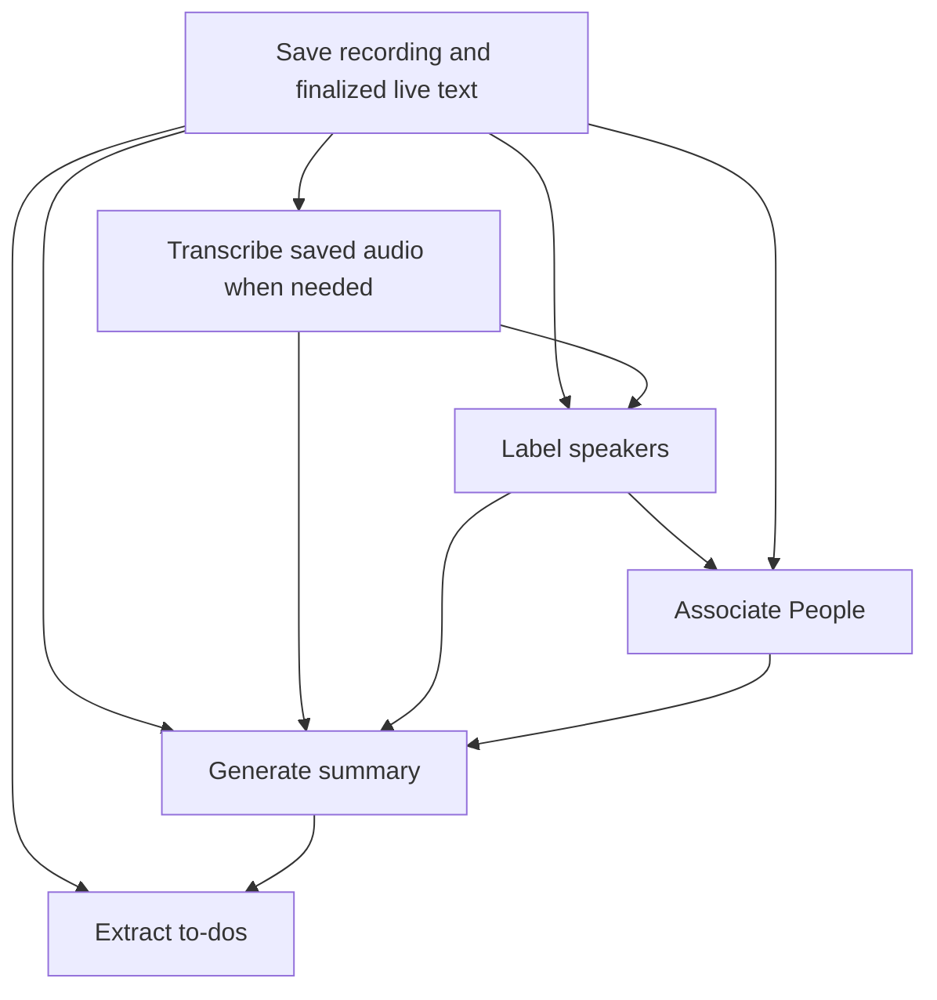

# Problem

Summary completion rejected transcript and notes changes, including speaker labeling. Recording completion scheduled summaries and speaker processing independently, so an ordinary dependency could invalidate a finished request. Generated summaries had no retained history.

# Implemented solution

- Persist the recording dependency graph as one task-journal event before stopping capture. A Save Recording receipt gates transcription, diarization, association, summary, and to-do extraction. Existing managed-task scheduling and recovery execute the graph.
- Wait for enabled and disabled dependencies to settle. No-data stages finish with an explanation; failures retain their task outcome. Automatic recovery remains pending rather than allowing dependents to run prematurely.
- Persist prepared summary prompts, image inputs, provider/model provenance, and results in private meeting artifacts. Commit history, the current summary, and its receipt through canonical transactions. Transcript edits do not reject generated output.
- Provide Summary History with read-only previews and restoration, preserving displaced edited content. To-do extraction uses the existing saved summary when automatic summarization is disabled; missing summary input is a successful no-data outcome.

# Reasoning

The task journal already owns admission, execution, concurrency limits, and recovery. Dependency records extend that engine instead of introducing another scheduler. Immutable summary requests preserve what the provider received; mutable transcript revision identifiers alone cannot do that.

# Technical debt

None. Interrupted recording finalization deliberately requires review rather than treating unconfirmed audio as complete. This is a recovery boundary, not a temporary fallback or parallel persistence path.

# Notes

The parent captured the existing Summary screen in an isolated synthetic preview before UI changes. The design adds Summary History beside generation controls, with a native sheet containing dated versions, provider/current labels, a read-only preview, Done, and Use This Summary. Current rendered summary and existing generation controls remain the primary view.

## Validation

- Independent review addressed dependency ordering through disabled stages, automatic recovery, finalization admission and cancellation, summary ordering, discarded dependency identities, and retrying summary extraction. Recovery reads completed extraction stages awaiting a summary result without decoding every historical prompt on wake.
- All 196 tests in 35 relevant suites passed, covering managed tasks, journal recovery, canonical persistence, recording finalization, summary snapshots and streaming, archive exports, and native transcript layout. Earlier tests expecting edits to invalidate summaries now verify saved output, preserved edits, and immutable input. Scheduler barrier fixtures use valid summary inputs. Logs: `/private/tmp/gday-pipeline-broad-final.log` and `/private/tmp/gday-pipeline-targeted-repair.log`.
- Strict formatting and `git diff --check` passed.
- Summary History was inspected in `tmp/source-indicators/Combined.app` with synthetic data. The sheet showed dates, providers, a current-version marker, and read-only text. Selecting an older version enabled **Use This Summary**; restoration changed the displayed summary and current marker. Escape dismissed the sheet. Automated tests separately cover preserving edited summaries and failed-write rollback.
- Final isolated `make build-macos` passed in `/private/tmp/gday-source-indicators`, including signing and platform verification (macOS 26.0 minimum, SDK 27.0). It includes the native Follow Live control and Tasks display guards. Log: `/private/tmp/gday-pipeline-final-release.log`. The final two Tasks rendering guards were compiled by the release build; the regression binary includes all backend changes.
- Existing Command Line Tools linker warnings report missing `Developer/usr/lib` and `Developer/Library/Frameworks` search directories. No deprecation warnings were reported.
- Validation used synthetic recordings and provider fixtures. Actual capture, paid provider requests, recognition accuracy, VoiceOver speech, and application termination during a real recording were not manually exercised.

## Dependency map

Disabled stages still wait for their predecessors before completing as skipped. This preserves transitive ordering: disabling speaker labeling cannot let association run ahead of transcription. A usable finalized live transcript can satisfy the transcription stage without another provider request. Search indexing consumes committed changes independently.

Optional processing failures remain visible in Tasks while downstream stages use available saved inputs. Failed work with automatic recovery is still pending; dependents wait for recovery instead of racing its retry. Missing data completes a stage with an explanation. Failure to commit recording finalization blocks use of that recording; descendants finish without processing its unconfirmed inputs. Save Recording cannot be cancelled or discarded while it is saving, because stopping capture is already in progress.

When summary generation is disabled, extraction uses the saved summary. When an enabled summary stage fails, extraction finishes without a new summary rather than extracting from an older version. A successful summary retry releases that same extraction stage. Already-applied extraction is not repeated. Retrying earlier speaker processing does not silently regenerate a completed summary; Generate Summary creates a new request when an updated summary is wanted.

Discarding a pipeline stage retains a terminal dependency record so its descendants can continue and recovery does not encounter a missing node. Settings and selected provider identities are captured at graph admission. Generation authority is a monotonic history ordinal reserved before task admission; manual input is captured at admission, while automatic input is prepared after dependencies settle.

The journal batch prevents partial graph admission, and canonical receipts reconcile a crash after result save but before task completion. If saving is interrupted before its finalization receipt, recovery requests review of saved audio. Local task admission and result application are idempotent; this does not promise exactly-once execution at a remote provider after an interrupted network request.

Summary history contains private prepared prompts and image inputs. Server archives exclude summary history, matching the existing exclusion of private transcript revisions; the current summary remains available through existing archive/export contracts. Opening Summary History performs local reads only.
